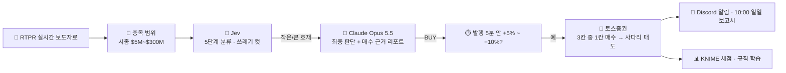

# How_To_Become_Warren_Buffett

> 미국 소형주 보도자료를 **AI 두 단계(Jev → Claude)** 가 읽고, 호재라고 판단하면 **분할 매수 · 분할 매도**로 자동 매매하는 실험.
> 판단 근거는 생성형 AI 가 한국어 리포트로 남기고, 결과는 **KNIME** 으로 채점 · 분석한다.
> 강원대학교 AI융합학과 「오픈소스프로그래밍」 기말 프로젝트 (2026-2).

⚠️ 투자 권유가 아니다. 소형주 뉴스 매매는 손실 가능성이 크고, 이 프로젝트의 목적은 수익이 아니라 시스템 구현과 검증이다.

## 무엇을 하나



| 역할 | 도구 | 이유 |
|---|---|---|
| 1단계 분류 | **Jev** (TypeSafe 결정 모델 · OpenRouter) | 글을 쓰지 않고 선택지별 확률만 준다 → 빠르고 매우 싸다. 악재 · 중립을 걸러 비싼 모델 호출을 줄인다 |
| 2단계 판단 | **Claude Opus 5.5** (OpenRouter) | 본문을 읽고 BUY/PASS 를 정하고, 사는 경우 **한국어 매수 근거 리포트를 생성**한다 |
| 매매 | 토스증권 Open API | 프리 · 정규 · 애프터마켓 지정가 주문 |
| 분석 | **KNIME** | AI 판단이 실제 주가와 맞았는지 혼동행렬로 채점, 의사결정나무로 매수 규칙 학습 |

## 매매 규칙 (요약 · 전체는 [`config/settings.yaml`](config/settings.yaml), [`docs/ARCHITECTURE.md`](docs/ARCHITECTURE.md))

이전에 만든 자동매매 프로그램의 매수 · 매도 규칙을 그대로 쓰고, 매수 신호만 바꿨다.

- 자금 3칸: 한 종목에 자금의 1/3 만. 3칸이 다 차면 더 사지 않는다
- 매수: Claude 가 BUY 라고 한 뒤, 뉴스 발행부터 5분 안에 발행 시점 가격 대비 +5% ~ +10% 구간이면 한 번에 매수 (+10% 위는 추격하지 않음 · 상한은 KNIME 결과로 다시 정함)
- 매도: +5 · +10 · +15% 에서 30% 씩 익절 · 나머지는 고점 대비 −5% 트레일링 · 손절 −7% · 5분 뒤 +2% 미만 / 15분 뒤 +5% 미만이면 전량
- 안전장치 (% 기준): 하루 실현손실 −10% 또는 3연패면 그날 매수 중단 · 자산이 시작 대비 −40% 면 정지

## 폴더

```
config/settings.yaml      매매 설정 (비밀값 아님)
src/hbwb/
  news/rtpr.py            RTPR WebSocket 알림 · 기사 본문
  universe.py             종목 범위 (시가총액)
  ai/jev.py · claude.py   1단계 · 2단계 AI (OpenRouter)
  broker/toss.py          토스 Open API (시세 · 계좌 · 주문)
  strategy/rules.py       3칸 · 매수 신호 · 사다리 매도 규칙 (순수 함수 · 실거래와 시뮬레이션이 같이 씀)
  strategy/backtest.py    1분봉 시뮬레이션 (KNIME 정답 라벨)
  engine/runner.py        전체 흐름 · 보유 관리
  report/daily.py         10:00 일일 보고서
scripts/                  run_live · check_setup · daily_report · watchdog · build_dataset · install_launchd
knime/                    KNIME 워크플로우 (.knwf) 와 노드 설정 가이드
tests/                    pytest (네트워크 차단 · 키 유출 검사 포함)
docs/                     설계 · 결정 기록 · 보안 · 인수인계
```

## 실행 (맥)

```bash
python3 -m venv .venv && .venv/bin/pip install -r requirements.txt
cp .env.example .env && chmod 600 .env          # 키는 편집기로 직접 입력
brew install pre-commit gitleaks && pre-commit install

.venv/bin/python -m pytest -q                   # 시험 (네트워크 안 씀)
.venv/bin/python scripts/check_setup.py --discord   # 키 · 토스 계좌 · AI · Discord 점검 (주문 없음 · 키가 없는 건 건너뜀)
.venv/bin/python scripts/run_live.py --mode paper   # 손으로 한 번 (가상 계좌 $1000 · 주문 없음 · Ctrl+C 로 끔)
```

### 한 줄 명령 · 대시보드

```bash
echo "alias hbwb='bash $HOME/Projects/How_To_Become_Warren_Buffett/scripts/hbwb.sh'" >> ~/.zshrc && source ~/.zshrc   # 한 번만
hbwb start | stop | restart | status   # 엔진 (paper · 24/7)
hbwb dash                              # 대시보드 http://127.0.0.1:8765 (가상 계좌 · 오늘 깔때기 · 보유 · 기사 · 거래 · AI 비용)
hbwb watch                             # 터미널에서 실시간 한 줄씩
hbwb report | history | check | errors
```

대시보드는 이 맥에서만 열리고(127.0.0.1) 파일을 읽기만 한다. 주문 · 설정을 바꾸는 기능은 없다.

### 24/7 무인 운영

```bash
bash scripts/install_launchd.sh --engine paper    # 엔진 상시 실행(가상 계좌 · 주문 없음) + 10:00 보고서 + 10분 감시 + 잠자기 방지
# 실거래: settings.yaml 의 mode.live_enabled: true 로 바꾼 뒤
bash scripts/install_launchd.sh --engine live
bash scripts/install_launchd.sh --status          # 상태 · 마지막 종료 코드 · heartbeat
bash scripts/install_launchd.sh --stop-engine     # 엔진만 내림
.venv/bin/python scripts/daily_report.py --history   # 시작부터 날마다 결과 표
```

- 엔진이 오류로 죽으면 60초 뒤 자동으로 다시 켜지고, 재시작해도 그날 손실 한도 · 연패 · 산 종목 기록이 이어진다
- 시작할 때 계좌와 기록을 맞춘다: 엔진이 걸어 둔 미체결 주문은 취소, 기록에 없는 보유가 있으면 #critical + 신규 매수 멈춤
- 매일 10:00 KST: 일일 보고서 (계좌 · 하루 손익 · 누적 · 엔진 상태) 를 보내고 하루 손실 · 연패 카운터를 리셋
- 실거래 전 확인: 토스 앱에서 **달러로 환전** (Open API 는 자동 환전하지 않는다) · 토스 허용 IP 에 이 맥의 공인 IP 등록
- 노트북은 **뚜껑을 열고 전원에 연결**해 둔다 (뚜껑을 닫으면 잠든다)

## KNIME

과거 기사(2026-05 ~ 10)에 같은 AI · 같은 매수 신호 · 같은 매도 규칙을 적용한 데이터셋을 만들어 KNIME 으로 분석한다.

```bash
.venv/bin/python scripts/build_dataset.py --stage prices   # 토스 1분봉 · 일봉 · 종목정보
.venv/bin/python scripts/build_dataset.py --estimate       # AI 비용 추정
.venv/bin/python scripts/build_dataset.py --stage jev
.venv/bin/python scripts/build_dataset.py --stage claude --claude-max 300
.venv/bin/python scripts/build_dataset.py --stage build    # → data/knime/news_dataset.csv
```

노드 구성은 [`knime/README.md`](knime/README.md).

## 보안

API 키는 `.env` 에만 있고 저장소에는 들어가지 않는다. `.gitignore` · pre-commit(gitleaks) · 시험 · GitHub Actions 이력 검사 · 로그 마스킹의 다섯 겹으로 막는다. 자세한 내용은 [`docs/SECURITY.md`](docs/SECURITY.md).

## 데이터 출처와 한계

- 뉴스: RTPR (원문 · 과거 자료는 약관상 저장소에 포함하지 않는다)
- 시세 · 종목정보: 토스증권 Open API (미국 시세는 일부 거래소 기준 · NBBO 아님)
- 과거 데이터셋의 시가총액은 현재 발행주식수로 근사한다 (그 사이 분할 · 증자가 있으면 오차)
- 1분봉 시뮬레이션은 한 봉 안에서 손절이 먼저 닿았다고 보는 보수적 가정을 쓴다

## 라이선스

MIT
