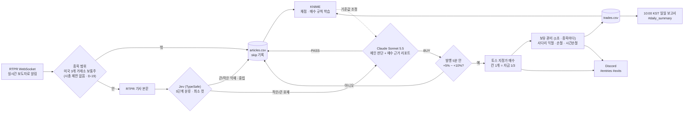

# 설계 (ARCHITECTURE)

## 1. 한 장 요약

| 단계 | 담당 | 무엇을 하나 | 실패하면 |
|---|---|---|---|
| 뉴스 | `news/rtpr.py` | WebSocket 알림 → 본문 받기 (`format=text`) | 다시 붙기 (2·4·…·60초), 키·구독 오류면 정지 + #critical |
| 종목 범위 | `universe.py` | 거래소 · 보통주 · ACTIVE · (설정하면) 시가총액 = sharesOutstanding × 전일 종가 · 지금 제한 없음 (D-19) | 모르면 `unclassified:*` 로 빼고 기록 (추측 금지) |
| 1단계 AI | `ai/jev.py` | 5단계 선택지 확률 → 작은/큰 호재만 통과 | 매수 안 함 |
| 2단계 AI | `ai/claude.py` | BUY/PASS + 근거 리포트(한국어) | JSON 깨지면 매수 안 함 |
| 매매 | `engine/runner.py` · `strategy/rules.py` | 3칸 · 5분 안 +5% ~ +10% 매수 (D-15) · 이전 프로그램 매도 · 애프터 끝 ET 19:50 (D-13) | 매도 미체결이면 가격 고쳐 다시, 그래도 남으면 #critical |
| 기록 | `ledger.py` · `eventlog.py` | CSV(KNIME 입력) · JSONL(전 과정) | 쓰기 전 비밀값 지움 |
| 보고 | `report/daily.py` | 10:00 KST 하루 손익 (D-12) | 계좌 조회 실패해도 보고서는 보냄 |

## 2. 매매 규칙 (`config/settings.yaml` 이 단일 출처)

출처: 이전 프로그램 `Auto_Trading_Program` (`9a780e7`) 의 규칙 (Auto_Trader_Futures D-154 (4)(5) 에 옮겨 적힌 그대로). 바꾼 것은 매수 신호 하나 (D-9).

- **자금 3칸**: 칸 하나 = min(예산 $100, 지금 자산) ÷ 3 으로 한 종목. 3칸이 모두 보유 · 신호 대기 중이면 매수 안 함. 칸 잠금 없음
- **매수 (한 번에)**: Claude BUY 뒤, 뉴스 발행 시각부터 5분 안에 기준가 × 1.05 ≤ 가격 ≤ 기준가 × 1.10 이면 지정가 = 신호 가격 × 1.007 (5초 안 미체결분 취소)
  - +10% 위면 사지 않고 5분 안에 구간으로 돌아오는지 본다 (D-15 · 임시 상한 · KNIME 결정트리로 다시 정한다)
  - 기준가 = 발행 전에 끝난 마지막 1분봉 종가 (30분 넘게 낡았으면 발행 뒤 첫 체결가, 그것도 없으면 감시 시작 가격)
- **매도 (1초마다 · 한 번에 하나 · 위에서부터)**
  1. 손익 ≤ −7% → 전량 (진입 30초 안에는 이것만 본다)
  2. 애프터마켓 끝 5분 전 → 전량 (애프터 끝 = 토스 기준 ET 19:50 · 장 캘린더가 20:00 을 주면 10분 당김 · D-13)
  3. 15분 지났고 손익 < +5% → 전량 · 5분 지났고 손익 < +2% → 전량
  4. +15% (TP3) → 원수량 30% + 트레일링 켬 · +10% (TP2) → 30% · +5% (TP1) → 30% (높은 단계부터, 한 번에 하나)
  5. 트레일링이 켜졌으면 고점 대비 −5% (ET 09:25~09:35 는 −3%) → 남은 물량 (약 10%)
- **안전장치 (% 기준)**: 그날 실현손실 ≤ 그날 시작 자산의 −10% → 그날 매수 중단 · 3연패 → 그날 매수 중단 · 자산 ≤ 시작 자금의 −40% → 시스템 정지 · 같은 종목은 미국 날짜 하루 한 번
- **세션**: 프리마켓 · 정규장 · 애프터마켓 (토스 장 캘린더). 토스 데이마켓은 매매하지 않는다
- 장외 시간에는 지정가만 받으므로 매수 · 매도 모두 지정가

같은 규칙 함수(`strategy/rules.py`)를 실거래 엔진과 과거 시뮬레이션(`strategy/backtest.py`)이 함께 쓴다 → KNIME 라벨이 실제 전략과 어긋나지 않는다.

## 3. 모드

| 모드 | 주문 | 용도 |
|---|---|---|
| `paper` (기본 · 예전 이름 `shadow`) | 보내지 않음 — 매도호가 ≤ 지정가면 매도호가에, 매도는 매수호가에 전량 체결됐다고 기록 | 가상 계좌 $1000 (`capital.paper_start_usd` · D-16). 현금 = 시작 + paper 실현손익 누적 − 보유 원가 → 다음 날 · 재시작에도 이어짐 |
| `live` | 토스 지정가 주문 | `--mode live` **그리고** `settings.yaml` 의 `mode.live_enabled: true` 둘 다 있어야 한다 |

paper 모드의 토스 클라이언트는 `allow_orders=False` 로 만들어 주문 함수가 예외를 던진다 (코드 버그가 있어도 주문이 나갈 길이 없다).

## 4. 24/7 무인 운영 (`scripts/install_launchd.sh`)

| launchd 작업 | 하는 일 | 다시 켜기 |
|---|---|---|
| `com.hbwb.engine` | `run_live.py --mode paper|live --quiet` | 로그인 때 시작 · 오류로 죽으면(종료 코드 1) 60초 뒤 다시. 키 · 구독 · 허용 IP 문제(종료 코드 0)는 다시 켜지 않는다 |
| `com.hbwb.awake` | `caffeinate -i -s` — 전원 연결 중 잠자기 방지 | 항상 |
| `com.hbwb.daily-report` | 매일 10:00 KST 일일 보고서 → #daily_summary (엔진이 멈춰 있으면 #critical 도) | 매일 |
| `com.hbwb.watchdog` | 10분마다 heartbeat 확인 → 15분 넘게 신호가 없으면 #critical (60분에 한 번) · 살아나면 알림 | 10분마다 |

- **엔진 안**: 세 루프(뉴스 · 보유 관리 · 관리) 중 하나라도 끝나면 엔진 전체를 멈춘다 → launchd 가 다시 켠다 (반쪽짜리로 계속 돌지 않게)
- **시작 점검 실패**(네트워크 · 맥이 막 깨어남)는 10초 → 최대 5분 간격으로 계속 다시 시도
- **하루 리셋**: KST 10:00 에 하루 실현손익 · 연패 카운터를 0 으로 (일일 보고서와 같은 경계 · `report.daily_time_kst` · D-12)
- **재시작해도 안전장치 유지**: 시작할 때 `trades.csv` 로 오늘 실현손익 · 연패 · 오늘 산 종목을 다시 만들고, `articles.csv` 로 이미 처리한 기사를 다시 처리하지 않는다. 보유 종목은 `data/state/positions.json` 과 계좌 매도가능수량을 맞춰 보고 이어서 관리 (수량이 다르면 신규 매수 정지 + #critical). 이어서 계좌 대조 (D-14): 이 엔진이 낸 미체결 주문은 취소, 기록에 없는 미국 주식 보유 · 모르는 미체결이 있으면 신규 매수 정지 + #critical
- **heartbeat**: 엔진이 5분마다 `data/state/heartbeat.json` 을 쓴다 (보유 · 대기 · 마지막 알림 시각 · 정지 사유)
- 한계: 노트북 뚜껑을 닫으면 잠든다 · 맥의 공인 IP 가 바뀌면 토스 허용 IP 밖이 된다 (#critical) · 맥이 재부팅되면 로그인해야 시작

## 5. 외부 API 사실 (2026-11-18 확인)

- 토스 Open API: 토큰은 클라이언트당 하나 · 허용 IP 목록 · 계좌 API 는 `X-Tossinvest-Account: accountSeq` · 주문 `LIMIT|MARKET` × `DAY|CLS|OPG` · US 가격 $1 미만 소수 4자리/이상 2자리 · `clientOrderId` 10분 멱등 · 미국 주식 정정은 가격만 · **자동 환전 없음 (USD 필요)** · 미국 시세는 일부 거래소 기준(NBBO 아님)
- OpenRouter: Jev = `POST /api/alpha/decisions` (`typesafe/jev-1.13`) · Claude = `POST /api/v1/chat/completions` (`anthropic/claude-opus-5.5`)
- RTPR: `wss://ws.rtpr.io/ws-alerts?apiKey=` · 키당 연결 하나 · 닫힘 4001 키 오류 / 4004 구독 끝
