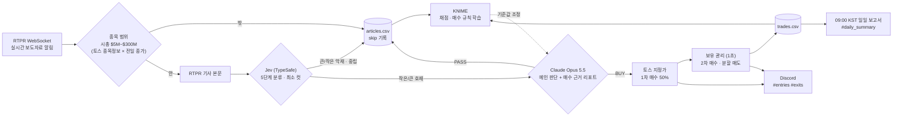

# 설계 (ARCHITECTURE)

## 1. 한 장 요약

| 단계 | 담당 | 무엇을 하나 | 실패하면 |
|---|---|---|---|
| 뉴스 | `news/rtpr.py` | WebSocket 알림 → 본문 받기 (`format=text`) | 다시 붙기 (2·4·…·60초), 키·구독 오류면 정지 + #critical |
| 종목 범위 | `universe.py` | 시가총액 = sharesOutstanding × 전일 종가 | 모르면 `unclassified:*` 로 빼고 기록 (추측 금지) |
| 1단계 AI | `ai/jev.py` | 5단계 선택지 확률 → 작은/큰 호재만 통과 | 매수 안 함 |
| 2단계 AI | `ai/claude.py` | BUY/PASS + 근거 리포트(한국어) | JSON 깨지면 매수 안 함 |
| 매매 | `engine/runner.py` · `strategy/rules.py` | 분할매수 2회 · 분할매도 | 매도 미체결이면 가격 고쳐 다시, 그래도 남으면 #critical |
| 기록 | `ledger.py` · `eventlog.py` | CSV(KNIME 입력) · JSONL(전 과정) | 쓰기 전 비밀값 지움 |
| 보고 | `report/daily.py` | 09:00 KST 하루 손익 | 계좌 조회 실패해도 보고서는 보냄 |

## 2. 매매 규칙 (`config/settings.yaml` 이 단일 출처)

- **분할매수**: 1차 = 예산 50% (지정가 = 매도1호가 +1%, 20초 안 미체결분 취소) · 2차 = 10분 안에 1차 평균가 +3% 돌파 시 남은 예산 (물타기 없음)
- **분할매도**: 손절 −5% 전량 · +10% 에서 절반 · 남은 물량은 +20% 또는 (1차 익절 뒤) 최고가 대비 −5% · 30분 시간 청산 · 애프터마켓 끝 5분 전 전량
- 우선순위: 손절 > 장 마감 > 시간 > 2차 익절 > 추적 손절 > 1차 익절
- **안전장치**: 동시 1종목 · 하루 실현손실 −$15 이면 신규 매수 중단 · 계좌 $60 미만이면 정지 · 하루 6거래 · 같은 종목 60분 쿨다운
- **세션**: 프리마켓 · 정규장 · 애프터마켓 (토스 장 캘린더). 토스 데이마켓은 매매하지 않는다
- 장외 시간에는 지정가만 받으므로 매수 · 매도 모두 지정가 (체결이 우선이 되도록 호가에서 조금 밀어서 낸다)

같은 규칙 함수(`strategy/rules.py`)를 실거래 엔진과 과거 시뮬레이션(`strategy/backtest.py`)이 함께 쓴다 → KNIME 라벨이 실제 전략과 어긋나지 않는다.

## 3. 모드

| 모드 | 주문 | 용도 |
|---|---|---|
| `shadow` (기본) | 보내지 않음 — 지금 호가에 체결됐다고 기록 | 키 · 연결 · 판단 흐름 점검 |
| `live` | 토스 지정가 주문 | `--mode live` **그리고** `settings.yaml` 의 `mode.live_enabled: true` 둘 다 있어야 한다 |

shadow 모드의 토스 클라이언트는 `allow_orders=False` 로 만들어 주문 함수가 예외를 던진다 (코드 버그가 있어도 주문이 나갈 길이 없다).

## 4. 재시작

보유 중 상태는 `data/state/position.json` 에 저장한다. 다시 켜면 계좌의 매도가능수량과 맞춰 보고 이어서 관리한다. 수량이 다르면 신규 매수를 멈추고 #critical.

## 5. 외부 API 사실 (2026-11-18 확인)

- 토스 Open API: 토큰은 클라이언트당 하나 · 허용 IP 목록 · 계좌 API 는 `X-Tossinvest-Account: accountSeq` · 주문 `LIMIT|MARKET` × `DAY|CLS|OPG` · US 가격 $1 미만 소수 4자리/이상 2자리 · `clientOrderId` 10분 멱등 · 미국 주식 정정은 가격만 · **자동 환전 없음 (USD 필요)** · 미국 시세는 일부 거래소 기준(NBBO 아님)
- OpenRouter: Jev = `POST /api/alpha/decisions` (`typesafe/jev-1.13`) · Claude = `POST /api/v1/chat/completions` (`anthropic/claude-opus-5.5`)
- RTPR: `wss://ws.rtpr.io/ws-alerts?apiKey=` · 키당 연결 하나 · 닫힘 4001 키 오류 / 4004 구독 끝
